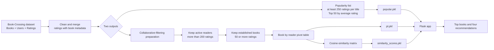

# Chapter Club — Book Recommender

Chapter Club is a Flask web app that turns a book you already enjoy into four related reading suggestions. It also presents a community-curated list of the 50 most highly rated popular titles.


## What powers the recommendations?

The project uses **collaborative filtering**. Instead of matching book descriptions or genres, it looks for titles that received similar ratings from the same readers.

- **Popularity shelf:** Books with at least 250 ratings are ranked by average rating; the top 50 are displayed on the home page.
- **Recommendation engine:** The training notebook keeps readers who have rated more than 200 books and books with at least 50 ratings from those readers. It then makes a book-by-user rating matrix and computes cosine similarity between book vectors. For a selected title, the app returns the four highest-similarity titles, excluding the selected book.

## Dataset

The model was trained using the [Book Recommendation Dataset on Kaggle](https://www.kaggle.com/datasets/arashnic/book-recommendation-dataset), which contains book metadata, user information, and user ratings from the Book-Crossing dataset.

The original CSV files are not needed to run the web app: the prepared artifacts (`popular.pkl`, `pt.pkl`, `books.pkl`, and `similarity_scores.pkl`) are included. Download the dataset if you want to rerun or change the training workflow in `book-recommender-system.ipynb`.

## Workflow



## Project structure

```text
app.py                         Flask routes and recommendation serving logic
templates/                     Responsive home and recommendation pages
static/images/library-hero.png Original hero image used by the site
book-recommender-system.ipynb  Data preparation and model-training notebook
*.pkl                          Prepared data and similarity-model artifacts
```

## Run locally

Use Python **3.11**. The bundled pickle files require pandas 1.5.x, which is declared in `requirements.txt`.

```powershell
py -3.11 -m venv .venv
.\.venv\Scripts\Activate.ps1
pip install -r requirements.txt
python -m flask --app app run --host 0.0.0.0 --port 5000
```

Then open `http://127.0.0.1:5000` in a normal local browser. In Codex’s in-app browser, use the host address shown by the Flask server instead of `127.0.0.1`.

## Deployment note

`Procfile` contains `web: gunicorn app:app` for Linux hosting platforms. `gunicorn` is not used for Windows local development; use Flask as shown above.
